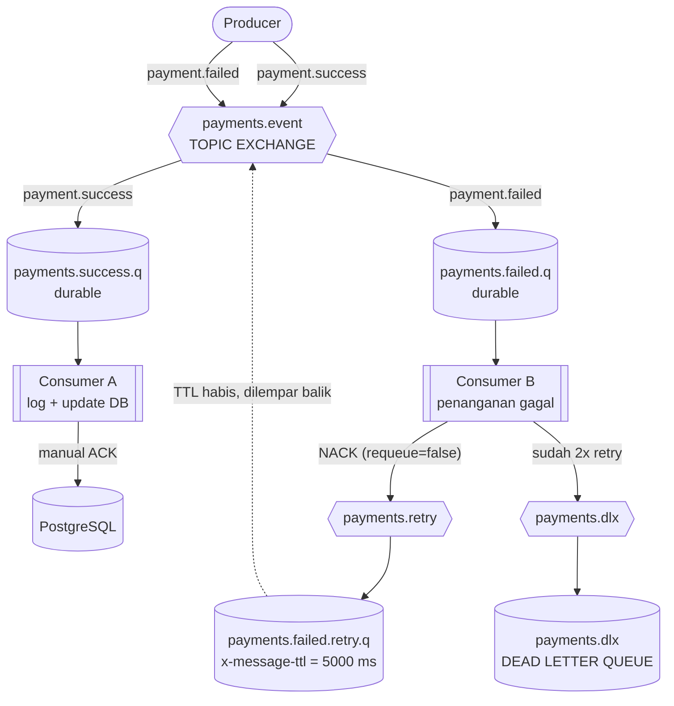

# Payments Event — RabbitMQ Topic Exchange, Retry & Dead Letter Queue

Implementasi **1 Producer + 2 Consumer** di atas **Topic Exchange** RabbitMQ,
lengkap dengan mekanisme **retry bertenggat (TTL)** dan **Dead Letter Queue**.

| Komponen | Routing key / Queue | Tugasnya |
|---|---|---|
| **Producer** | kirim ke exchange `payments.event` | menerbitkan event `payment.success` dan `payment.failed` |
| **Consumer A** | binding `payment.success` → `payments.success.q` | log + update database. Queue durable, manual ACK |
| **Consumer B** | binding `payment.failed` → `payments.failed.q` | retry 2x dengan jeda 5 detik, lalu kirim ke DLQ `payments.dlx` |

---

## 1. Arsitektur



### Jalan ceritanya

1. Producer mengirim event ke exchange `payments.event` bertipe **topic**.
   Routing key menentukan queue mana yang menerima.
2. `payment.success` → **Consumer A** → tulis log, update tabel `payments`
   jadi `PAID`, baru kirim **ACK manual**.
3. `payment.failed` → **Consumer B**. Kalau penanganannya gagal, pesan
   di-**NACK dengan `requeue=false`**.
4. Karena `payments.failed.q` punya argumen `x-dead-letter-exchange`,
   RabbitMQ otomatis melempar pesan itu ke `payments.retry` →
   mengendap di `payments.failed.retry.q`.
5. Queue retry itu **tidak punya consumer**. Pesan hanya menunggu di sana
   selama `x-message-ttl` (5 detik). Setelah TTL habis, pesan dilempar
   balik ke `payments.event` dan masuk lagi ke `payments.failed.q`.
6. Consumer B menghitung sudah berapa kali pesan lewat jalur retry
   (dibaca dari header `x-death` yang ditambahkan RabbitMQ sendiri).
   Setelah **2 kali retry** masih gagal, pesan dikirim ke
   `payments.dlx` dan berhenti di sana untuk diperiksa manusia.

> **Kenapa pakai queue retry terpisah, bukan `requeue=true`?**
> `requeue=true` mengembalikan pesan ke antrean yang sama **saat itu juga**,
> sehingga terjadi perulangan tanpa jeda yang membebani CPU. Queue dengan
> TTL memberi jeda nyata sekaligus batas percobaan yang jelas.

---

## 2. Yang perlu disiapkan

Cuma **Docker**. Tidak perlu memasang Node.js, RabbitMQ, atau PostgreSQL
di komputer sendiri.

- Docker Desktop (Windows / macOS) atau Docker Engine (Linux)
- Pastikan sudah jalan: `docker --version` dan `docker compose version`

---

## 3. Cara menjalankan

```bash
# 1. ambil kode
git clone https://github.com/picasold/rabbitmq-payments.git
cd rabbitmq-payments

# 2. nyalakan RabbitMQ, PostgreSQL, dan kedua consumer
docker compose up -d --build

# 3. tunggu sampai semuanya "healthy" (sekitar 30 detik)
docker compose ps
```

Buka **Management UI** di browser: <http://localhost:15672>
Login: **admin** / **admin123**

```bash
# 4. buka log kedua consumer di satu terminal, biarkan terbuka
docker compose logs -f consumer-success consumer-failed
```

```bash
# 5. di terminal lain, kirim pesan
docker compose run --rm producer
```

Perintah di langkah 5 mengirim paket demo: **3 pesan sukses**,
**1 pesan gagal-sementara**, dan **1 pesan gagal-permanen** — supaya ketiga
jalur (sukses, pulih setelah retry, dan masuk DLQ) terlihat sekaligus.

### Mengirim pesan sesuai keinginan

```bash
# 5 pesan sukses saja
docker compose run --rm producer node src/producer.js --success 5

# 2 pesan gagal yang pasti berakhir di DLQ
docker compose run --rm producer node src/producer.js --failed 2 --scenario permanent

# 2 pesan gagal yang pulih di percobaan kedua
docker compose run --rm producer node src/producer.js --failed 2 --scenario transient
```

### Memeriksa hasilnya

```bash
# isi Dead Letter Queue (pesan tidak ikut terhapus)
docker compose run --rm producer npm run dlq:inspect

# ringkasan database + riwayat tiap percobaan retry
docker compose run --rm producer npm run db:report
```

### Menghentikan

```bash
docker compose down          # hentikan semua container
docker compose down -v       # sekalian hapus data RabbitMQ & PostgreSQL
```

---

## 4. Contoh keluaran

**Consumer A — jalur sukses**

```
[consumer-A] terima payment.success  ORD-DC6C87D6  Rp65.170,69  via BRI
[consumer-A] OK DB updated -> payment_id=dc6c87d6-... status=PAID
```

**Consumer B — retry lalu pulih** (`scenario=transient`)

```
[consumer-B] terima ORD-FA6D8DC6  percobaan ke-1  (retry terpakai 0/2)  reason=GATEWAY_TIMEOUT
[consumer-B] WARN ORD-FA6D8DC6 gagal -> NACK, dicoba lagi dalam 5s (sisa retry 2)
[consumer-B] terima ORD-FA6D8DC6  percobaan ke-2  (retry terpakai 1/2)
[consumer-B] OK ORD-FA6D8DC6 berhasil ditangani di percobaan ke-2 -> ACK
```

**Consumer B — habis jatah retry, masuk DLQ** (`scenario=permanent`)

```
[consumer-B] terima ORD-6E3948D5  percobaan ke-1  (retry terpakai 0/2)  reason=CARD_DECLINED
[consumer-B] WARN gagal -> NACK, dicoba lagi dalam 5s (sisa retry 2)
[consumer-B] terima ORD-6E3948D5  percobaan ke-2  (retry terpakai 1/2)
[consumer-B] WARN gagal -> NACK, dicoba lagi dalam 5s (sisa retry 1)
[consumer-B] terima ORD-6E3948D5  percobaan ke-3  (retry terpakai 2/2)
[consumer-B] DLQ ORD-6E3948D5 gagal 3x -> dikirim ke "payments.dlx"
```

Perhatikan jarak waktunya: `10:37:34` → `10:37:40` → `10:37:45`, yaitu jeda
**5 detik** persis sesuai `x-message-ttl`.

---

## 5. Tangkapan layar Management UI

| Berkas | Isinya |
|---|---|
| `docs/screenshots/01-overview.png` | Halaman Overview |
| `docs/screenshots/02-exchanges.png` | Ketiga exchange: `payments.event`, `payments.retry`, `payments.dlx` (semua **topic**, **D**urable) |
| `docs/screenshots/03-queues.png` | Keempat queue beserta label **D**, **TTL**, **DLX**, **DLK** |
| `docs/screenshots/04-dlq-payments.dlx.png` | Isi DLQ: payload + header `x-dead-reason`, `x-retry-attempts: 3` |
| `docs/screenshots/05-exchange-payments.event.png` | Binding `payment.success` dan `payment.failed` |
| `docs/screenshots/06-queue-failed.png` | Detail `payments.failed.q` beserta argumennya |
| `docs/screenshots/07-queue-retry-ttl.png` | Detail queue retry: `x-message-ttl = 5000` |

Mau mengambil ulang sendiri? Jalankan langkah 1–5, lalu di Management UI
buka tab **Exchanges**, **Queues and Streams**, dan klik queue
`payments.dlx` → bagian **Get messages** → tombol **Get Message(s)**.

---

## 6. Peta berkas

```
.
├── docker-compose.yml        # RabbitMQ + PostgreSQL + 2 consumer + producer
├── Dockerfile                # image Node.js untuk producer & consumer
├── db/init.sql               # skema tabel, dijalankan otomatis
├── src/
│   ├── config.js             # semua nama exchange/queue/routing key
│   ├── topology.js           # membuat exchange, queue, binding
│   ├── producer.js           # pengirim event
│   ├── consumer-success.js   # CONSUMER A
│   ├── consumer-failed.js    # CONSUMER B (retry + DLX)
│   ├── db.js                 # akses PostgreSQL
│   └── logger.js
├── scripts/
│   ├── inspect-dlq.js        # melihat isi DLQ
│   └── db-report.js          # ringkasan database
└── docs/screenshots/
```

---

## 7. Pemetaan ke poin tugas

| Permintaan | Di mana diselesaikan |
|---|---|
| Topic exchange `payments.event` | `src/topology.js` — `assertExchange(..., 'topic', { durable: true })` |
| Dua routing key berbeda | `src/producer.js` — `payment.success` & `payment.failed` |
| Consumer A binding `payment.success` | `src/consumer-success.js` + binding di `topology.js` |
| Log & update DB | `src/consumer-success.js` → `markPaymentPaid()` di `src/db.js` |
| Queue durable | semua `assertQueue(..., { durable: true })` |
| Manual ACK | `channel.consume(..., { noAck: false })` lalu `channel.ack(msg)` |
| Consumer B binding `payment.failed` | `src/consumer-failed.js` |
| Retry 2x | `MAX_RETRY = 2` di `src/config.js`, dihitung dari header `x-death` |
| TTL 5 detik | `x-message-ttl: 5000` pada `payments.failed.retry.q` |
| Masuk DLQ `payments.dlx` | exchange `payments.dlx` → queue `payments.dlx` |
| Cara run dengan Docker | bagian 3 di README ini |

---

## 8. Pengaturan

Nilai bawaan bisa diubah lewat berkas `.env` (lihat `.env.example`):

| Variabel | Bawaan | Arti |
|---|---|---|
| `RABBITMQ_USER` / `RABBITMQ_PASS` | `admin` / `admin123` | akun Management UI |
| `RETRY_TTL_MS` | `5000` | jeda sebelum pesan dicoba lagi |
| `MAX_RETRY` | `2` | jumlah retry sebelum masuk DLQ |
| `PREFETCH` | `1` | berapa pesan dipegang consumer sebelum ACK |

---

## 9. Kalau ada masalah

| Gejala | Penyebab & solusi |
|---|---|
| `port is already allocated` | Port 5672/15672/5432 dipakai aplikasi lain. Hentikan aplikasi itu, atau ubah bagian `ports:` di `docker-compose.yml` |
| Consumer terus menulis "RabbitMQ belum siap" | Wajar di 10–20 detik pertama; broker masih menyala. Kalau lebih dari 1 menit, cek `docker compose logs rabbitmq` |
| Management UI tidak terbuka | Pastikan `docker compose ps` menunjukkan rabbitmq `healthy`, lalu buka <http://localhost:15672> |
| Pesan menumpuk di `payments.failed.retry.q` | Normal — pesan sedang menunggu TTL 5 detik, setelah itu otomatis pindah |
| Ingin mulai dari nol | `docker compose down -v` lalu `docker compose up -d --build` |

---

## 10. Catatan teknis

- **Publisher confirm.** Producer memakai `createConfirmChannel()` dan
  `waitForConfirms()`, jadi pesan dianggap terkirim hanya setelah broker
  benar-benar menerimanya.
- **Pesan persisten.** Semua pesan dikirim dengan `persistent: true` dan
  semua queue `durable: true`, sehingga data selamat walau broker di-restart.
- **`prefetch(1).`** Tiap consumer memegang maksimal satu pesan sebelum ACK,
  supaya beban terbagi rata kalau consumer diperbanyak
  (`docker compose up -d --scale consumer-success=3`).
- **Idempoten.** Perintah `INSERT ... ON CONFLICT` membuat pesan yang
  kebetulan terkirim dua kali tidak menghasilkan baris ganda.
- **Penghitungan retry** memakai header `x-death` bawaan RabbitMQ, bukan
  penghitung buatan sendiri, agar jumlahnya tetap akurat walau consumer
  di-restart di tengah jalan.
